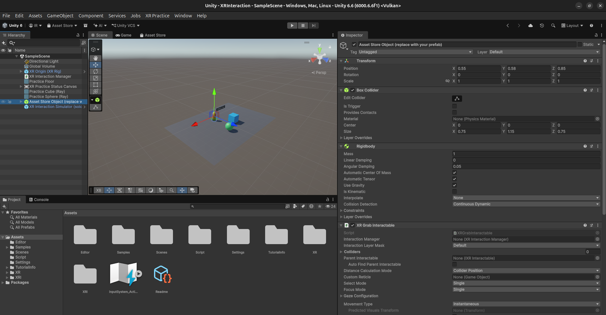
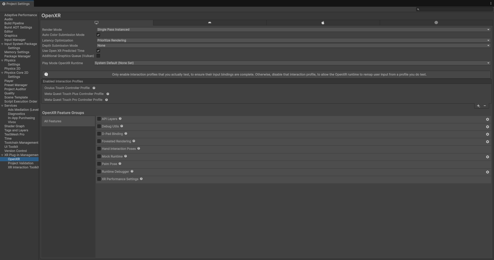

# Práctica: XR Interaction Toolkit y OpenXR

Proyecto Unity 6 con XR Plug-in Management, OpenXR y XR Interaction Toolkit. La escena de práctica se encuentra en `Assets/Scenes/SampleScene.unity`.

## Capturas

## Qué incluye

- XR Origin (XR Rig) de Starter Assets con cámara, mandos, interacción cercana/lejana y locomoción de muestra.
- Simulador XR Interaction Simulator de Starter Assets para probar en Play Mode sin un visor.
- Cubo y esfera con `Collider`, `Rigidbody` y `XR Grab Interactable`; cambian de color al seleccionarlos.
- Objeto compuesto provisional para interacción directa, con `Collider`, `Rigidbody` y `XR Grab Interactable`; sustitúyelo por un prefab de la Asset Store si la entrega requiere un modelo externo. No se redistribuye contenido de terceros en este repositorio.
- Panel de UI que muestra los eventos de agarrar y soltar el objeto cercano.
- OpenXR asignado a Standalone y Android, con perfiles Oculus Touch, Meta Quest Touch Plus y Touch Pro activados cuando están disponibles.

El simulador externo Meta XR no se incluye: es una herramienta aparte del paquete de Unity y esta práctica usa el simulador genérico oficial del XR Interaction Toolkit como alternativa.

## Requisitos

- Unity 6.6.6f1 (versión del proyecto).
- Android Build Support y OpenJDK/SDK de Unity para compilar a Quest.
- Para ejecutar la aplicación en Quest, un visor compatible y sus perfiles de controlador en OpenXR.

## Abrir y probar

1. Abre este directorio como proyecto en Unity. Los paquetes se resuelven desde `Packages/manifest.json`.
2. Ejecuta **XR Practice > Import Samples, Configure OpenXR and Build Scene**. Importa las muestras, configura OpenXR y guarda la escena. También puedes importar las muestras desde Package Manager y ejecutar **XR Practice > Build Practice Scene**.
3. En **Edit > Project Settings > XR Plug-in Management**, confirma OpenXR para **Standalone** (simulación en escritorio) y **Android** (Quest).
4. En OpenXR, confirma Oculus Touch y Meta Quest Touch Plus. Touch Pro queda activado para Quest Pro; Eye Gaze es opcional. Revisa las validaciones según la plataforma de destino; si Starter Assets solicita TMP Essentials, impórtalo desde **Window > TextMeshPro > Import TMP Essential Resources**.
5. Abre `Assets/Scenes/SampleScene.unity`. La escena XR queda guardada y lista para Play Mode.
6. Para reemplazar el objeto provisional, usa un prefab de la Asset Store y conserva en su raíz `Collider`, `Rigidbody` y `XR Grab Interactable`. Conecta `GrabStatusUI` al texto de estado.
7. El simulador genérico se usa en Play Mode. Desactiva `XR Interaction Simulator (solo Play Mode)` antes de compilar a Quest.

### Controles del simulador Meta

Si instalas Meta XR Simulator aparte, sus controles por defecto son: WASD para mover la cámara; botón derecho + ratón para rotar; `1`/`2` para activar manos; `R` para alternar Ray Interactor; clic izquierdo para agarrar y Espacio para UI click.

### Verificación de la escena

- Apunta con el interactor lejano al cubo o la esfera y selecciónalos: cambian de color mientras están seleccionados.
- Acércate al objeto provisional y agárralo con el interactor directo: el panel muestra el estado de agarre y soltado.

Los pasos y detalles ampliados también están en [`XR_PRACTICE_SETUP.md`](XR_PRACTICE_SETUP.md).
